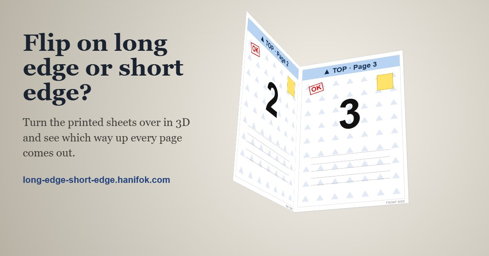

# Long Edge, Short Edge

A free, interactive simulator for Adobe Reader's print settings. Set up a copy of Reader's Print window, then pick up the printed paper in 3D and turn it over to see which page ends up where, and which way up.

**Live site: https://long-edge-short-edge.hanifok.com/**



## Why

"Flip on long edge" and "Flip on short edge" confuse a lot of people. Pick the wrong one and every back page comes out upside down. Booklets, posters and several pages per sheet add even more ways to get it wrong. This site lets you try the settings and see the result before you print.

## What it does

- A copy of Reader's Print window with its real options: pages to print, Size, Poster, Multiple and Booklet, orientation, and printing on both sides.
- A 3D preview of the printed sheets. Drag the top sheet left or right to turn it like a book page, or up or down to turn it like a calendar. Drag outside the paper to rotate the view all the way around.
- A plain-language readout that says which pages you are looking at and whether each one is upright, upside down or on its side. If you turn a sheet over the wrong edge, it tells you which setting to change.
- Booklets can be folded and read page by page, bound on the left or the right.
- You can use your own PDF. It is opened in your browser with PDF.js and never uploaded.

## Run it locally

There is no build step and nothing to install. Open `index.html` in a browser, or serve the folder:

```
python -m http.server 8000
```

then go to http://localhost:8000/.

Opening the file straight from disk also works. PDF.js then runs on the page instead of in a background worker, so large PDFs open a little more slowly.

## Tests

The print layout logic in `layout.js` does not need a browser. Check it with Node:

```
node test/layout.test.js
```

## Files

| File | What it does |
| --- | --- |
| `index.html` | The page, the Print window and the help text |
| `layout.js` | Works out where every page lands on every sheet: grids for several pages per sheet, booklet order, poster tiles, and which way up the back is printed |
| `viewer.js` | The 3D preview, the dragging and the readout |
| `app.js` | Connects the Print window to the layout and the preview |
| `pdfdoc.js` | Opens your own PDF and draws its pages |
| `lib/pdfjs/` | PDF.js 6.3.289 by Mozilla, converted to plain scripts (see `lib/pdfjs/README.txt`) |

The site is hosted on GitHub Pages straight from the `main` branch. The custom domain is set in `CNAME`.

## Limits

- Each sheet is drawn the way you would hold it to read the front. Your printer may feed the paper in a different direction.
- Printer drivers have their own two-sided setting, and it often overrides Reader's.
- Posters are shown printed on one side only.

## Credits

PDF.js is made by Mozilla and licensed under the Apache License 2.0 (see `lib/pdfjs/LICENSE`).

Adobe, Acrobat and Adobe Reader are trademarks of Adobe Inc. This project is not affiliated with or endorsed by Adobe.

Made by [Hanif Omar Kertapati](https://hanifok.com/).
